# HW5 — Агрегатные функции и группировка

База данных кинотеатра, PostgreSQL. Используется та же схема после HW2, что и в HW4: movies, halls, customers, sessions, tickets, genres.

По два запроса в 14 разделах: всего 28 запросов. В разделах 1–11 рассмотрены агрегатные функции и группировки. Раздел 12 объединяет SELECT, FROM, WHERE, GROUP BY, HAVING и ORDER BY. Разделы 13–14 соответствуют темам презентации «Комбинирование функций» и «Разница между WHERE и HAVING».

К каждому запросу приложен скриншот выполнения в pgAdmin. Все запросы читают данные и не изменяют таблицы.

## 1. COUNT()

### 1.1. Посчитать общее количество фильмов.

```sql
SELECT COUNT(*) AS movie_count
FROM movies;
```

**Пояснение:** COUNT(*) считает все строки таблицы.

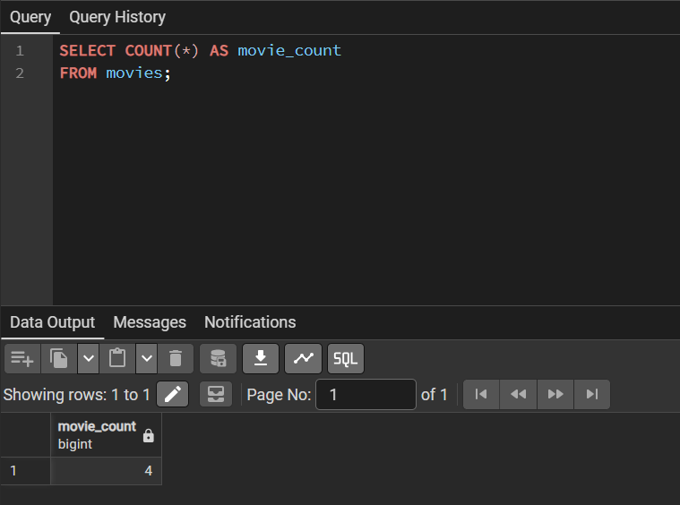

### 1.2. Посчитать количество проданных билетов.

```sql
SELECT COUNT(*) AS sold_ticket_count
FROM tickets
WHERE status = 'sold';
```

**Пояснение:** Сначала WHERE оставляет проданные билеты, затем COUNT(*) считает их.

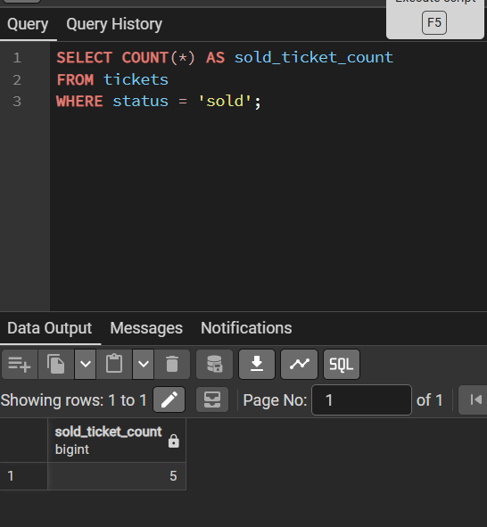

## 2. SUM()

### 2.1. Посчитать общую вместимость всех залов.

```sql
SELECT SUM(capacity) AS total_capacity
FROM halls;
```

**Пояснение:** SUM складывает значения выбранного столбца.

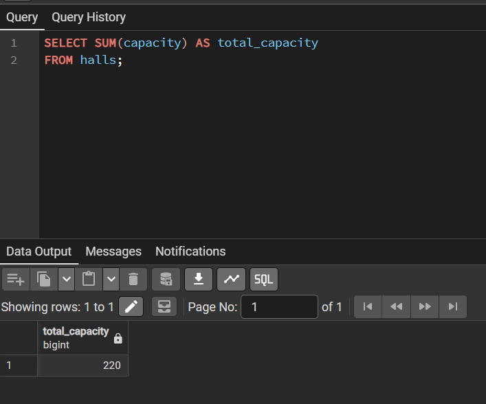

### 2.2. Посчитать суммарную длительность всех фильмов в минутах.

```sql
SELECT SUM(duration_min) AS total_duration_min
FROM movies;
```

**Пояснение:** Складываем длительности фильмов. Значения NULL агрегат пропускает.

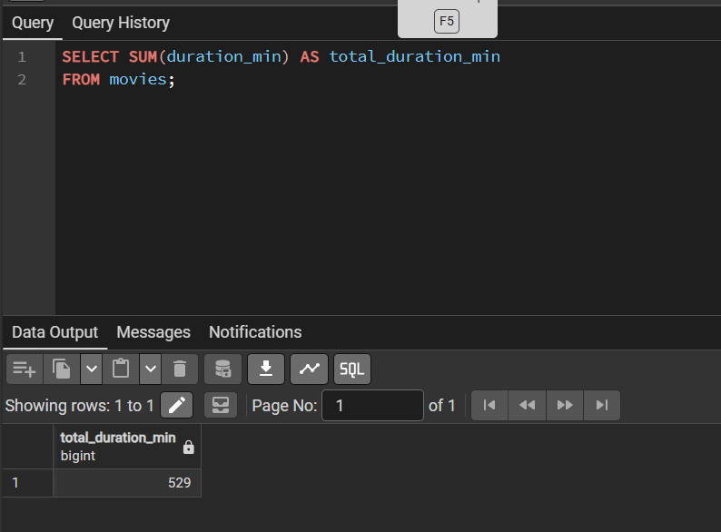

## 3. AVG()

### 3.1. Найти средний рейтинг фильмов.

```sql
SELECT ROUND(AVG(rating), 2) AS average_rating
FROM movies;
```

**Пояснение:** AVG вычисляет среднее по значениям, отличным от NULL. ROUND округляет до двух знаков.

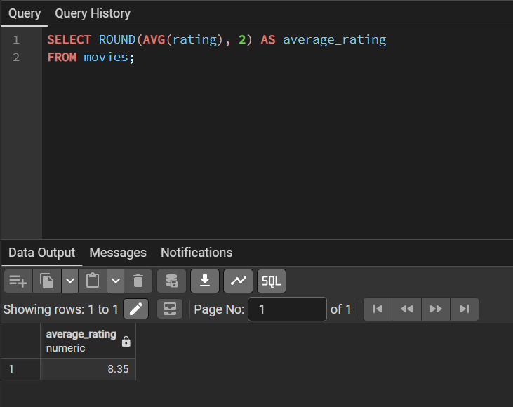

### 3.2. Найти среднюю цену сеанса.

```sql
SELECT ROUND(AVG(price), 2) AS average_price
FROM sessions;
```

**Пояснение:** AVG вычисляет среднее по ценам сеансов, пропуская NULL. Цена 0 тоже участвует в среднем.

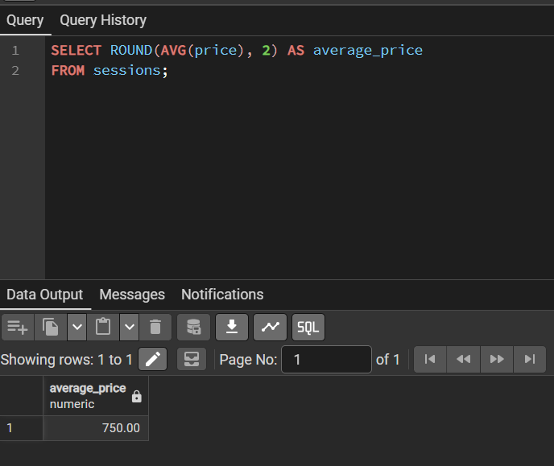

## 4. MIN()

### 4.1. Найти длительность самого короткого фильма.

```sql
SELECT MIN(duration_min) AS shortest_duration_min
FROM movies;
```

**Пояснение:** MIN возвращает минимальное значение, а не всю строку фильма.

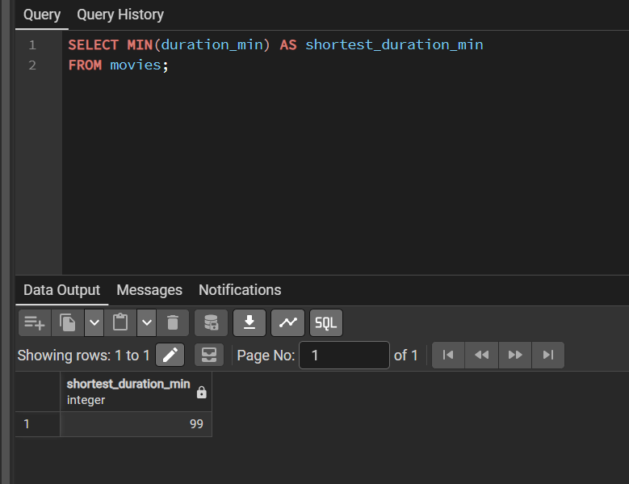

### 4.2. Найти минимальную цену сеанса.

```sql
SELECT MIN(price) AS minimum_price
FROM sessions;
```

**Пояснение:** Получаем наименьшую цену среди сеансов.

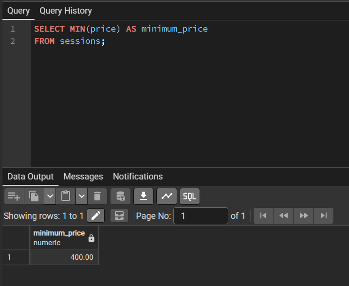

## 5. MAX()

### 5.1. Найти самый высокий рейтинг фильма.

```sql
SELECT MAX(rating) AS highest_rating
FROM movies;
```

**Пояснение:** MAX возвращает максимальное значение столбца.

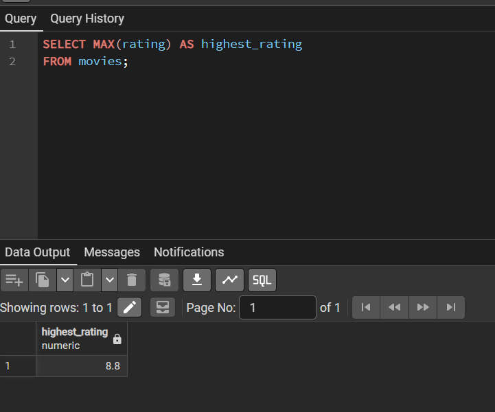

### 5.2. Найти вместимость самого большого зала.

```sql
SELECT MAX(capacity) AS largest_capacity
FROM halls;
```

**Пояснение:** Получаем максимальное количество мест в одном зале.

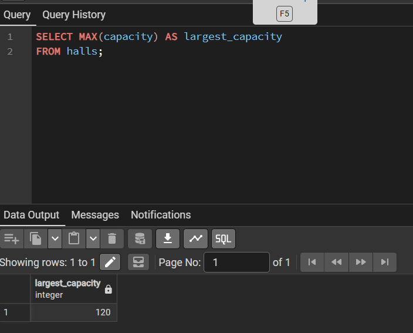

## 6. STRING_AGG()

### 6.1. Собрать названия всех фильмов в одну строку по алфавиту.

```sql
SELECT STRING_AGG(title, ', ' ORDER BY title) AS movie_titles
FROM movies;
```

**Пояснение:** STRING_AGG объединяет строки через разделитель. ORDER BY внутри функции задаёт порядок названий.

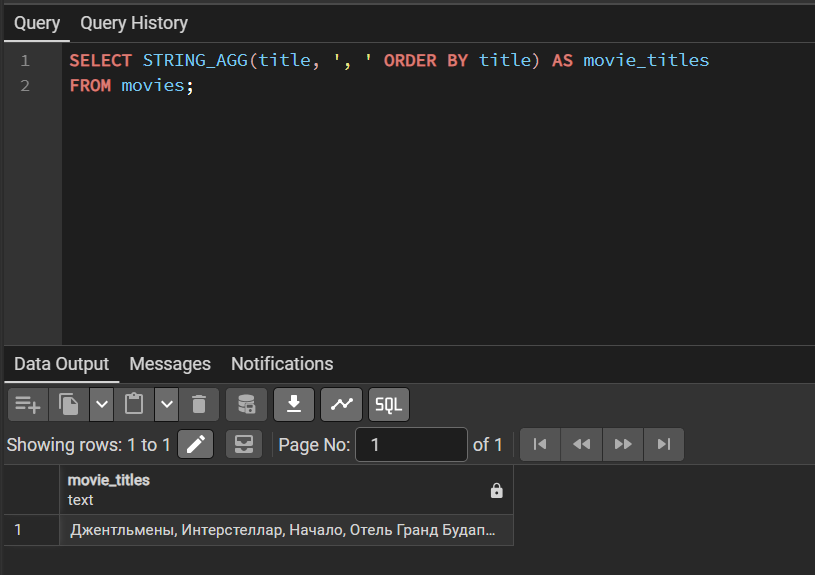

### 6.2. Собрать имена клиентов со скидкой в одну строку.

```sql
SELECT STRING_AGG(name, ', ' ORDER BY name) AS customers_with_discount
FROM customers
WHERE discount_percent > 0;
```

**Пояснение:** Сначала выбираем клиентов со скидкой, затем соединяем имена через запятую.

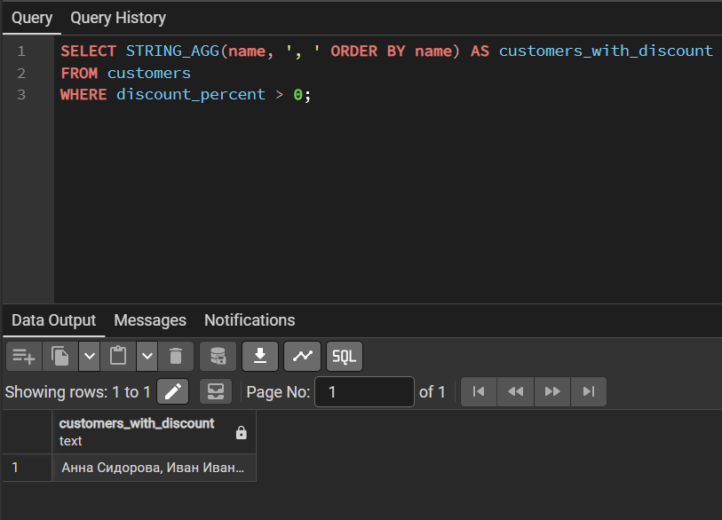

## 7. GROUP BY

### 7.1. Посчитать фильмы для каждой страны производства.

```sql
SELECT country, COUNT(*) AS movie_count
FROM movies
GROUP BY country
ORDER BY country;
```

**Пояснение:** GROUP BY объединяет фильмы с одинаковой страной, а COUNT считает строки каждой группы.

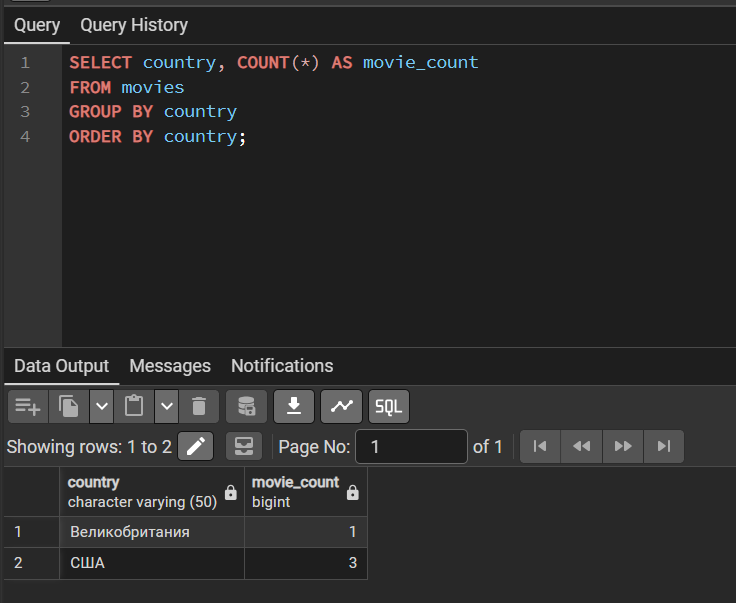

### 7.2. Посчитать билеты каждого статуса.

```sql
SELECT status, COUNT(*) AS ticket_count
FROM tickets
GROUP BY status
ORDER BY status;
```

**Пояснение:** Каждый статус образует отдельную группу.

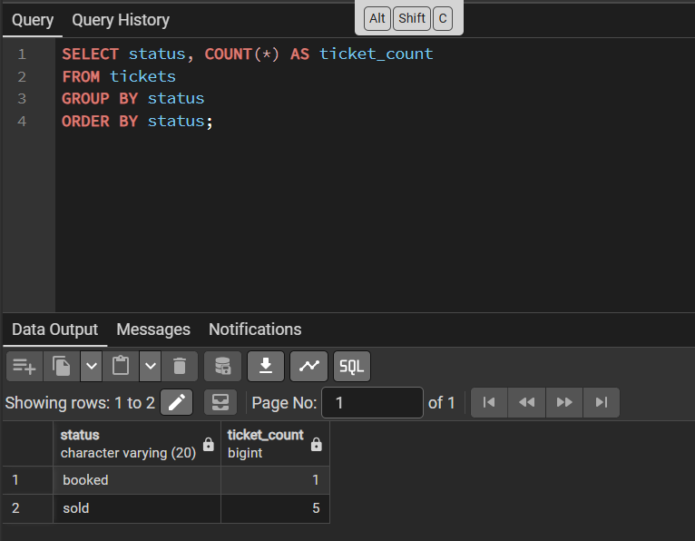

## 8. HAVING

### 8.1. Найти страны, для которых в базе есть не меньше двух фильмов.

```sql
SELECT country, COUNT(*) AS movie_count
FROM movies
GROUP BY country
HAVING COUNT(*) >= 2
ORDER BY country;
```

**Пояснение:** HAVING фильтрует группы после подсчёта: оставляет страны с двумя и более фильмами.

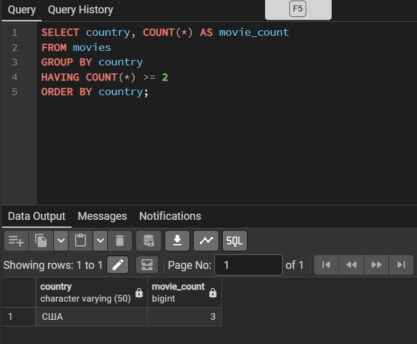

### 8.2. Найти сеансы, для которых продано не меньше двух билетов.

```sql
SELECT session_id, COUNT(*) AS sold_ticket_count
FROM tickets
WHERE status = 'sold'
GROUP BY session_id
HAVING COUNT(*) >= 2
ORDER BY session_id;
```

**Пояснение:** WHERE отбирает проданные билеты до группировки. HAVING оставляет группы с нужным количеством.

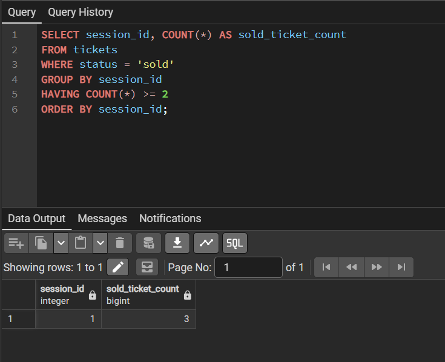

## 9. GROUPING SETS

### 9.1. Посчитать фильмы отдельно по странам и отдельно по жанрам.

```sql
SELECT CASE WHEN GROUPING(country) = 1 THEN 'Все страны'
            ELSE COALESCE(country, 'Страна не указана') END AS country,
       CASE WHEN GROUPING(genre_id) = 1 THEN 'Все жанры'
            ELSE COALESCE(genre_id::text, 'Жанр не указан') END AS genre,
       COUNT(*) AS movie_count
FROM movies
GROUP BY GROUPING SETS ((country), (genre_id))
ORDER BY GROUPING(country), country, genre;
```

**Пояснение:** Два набора группировки дают независимые подсчёты по странам и по жанрам. GROUPING отличает итог от обычного NULL. Номера жанров соответствуют genres.id.

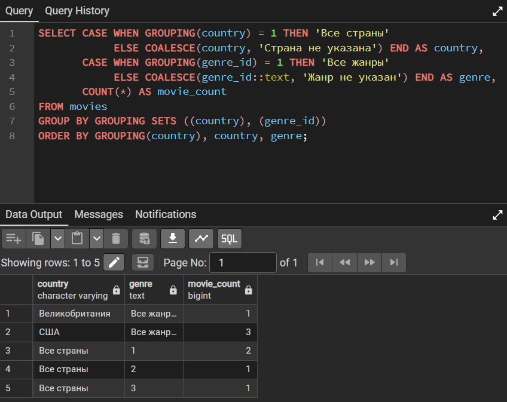

### 9.2. Посчитать билеты по сеансам и статусам, по сеансам и всего.

```sql
SELECT CASE WHEN GROUPING(session_id) = 1 THEN 'Все сеансы'
            ELSE COALESCE(session_id::text, 'Сеанс не указан') END AS session,
       CASE WHEN GROUPING(status) = 1 THEN 'Все статусы'
            ELSE COALESCE(status, 'Статус не указан') END AS status,
       COUNT(*) AS ticket_count
FROM tickets
GROUP BY GROUPING SETS ((session_id, status), (session_id), ())
ORDER BY GROUPING(session_id), session_id, GROUPING(status), status;
```

**Пояснение:** Первая группировка детальная, вторая даёт итоги по сеансам, пустой набор () — общий итог.

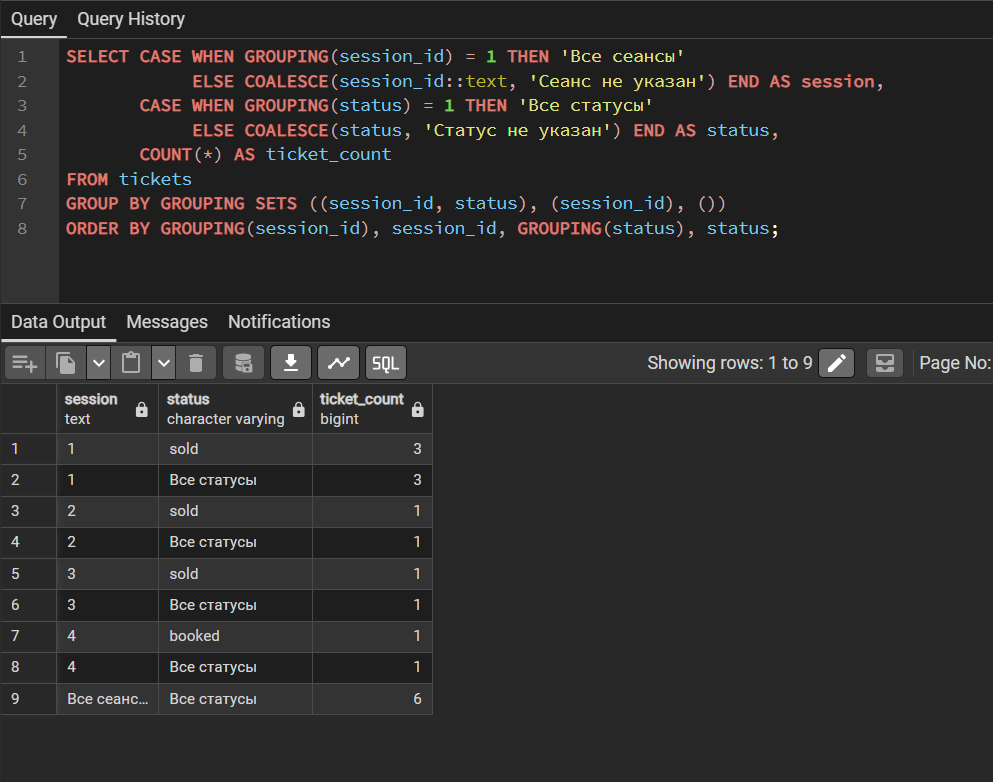

## 10. ROLLUP

### 10.1. Посчитать фильмы по странам и жанрам, добавить итоги по странам и общий итог.

```sql
SELECT CASE WHEN GROUPING(country) = 1 THEN 'Все страны'
            ELSE COALESCE(country, 'Страна не указана') END AS country,
       CASE WHEN GROUPING(genre_id) = 1 THEN 'Все жанры'
            ELSE COALESCE(genre_id::text, 'Жанр не указан') END AS genre,
       COUNT(*) AS movie_count
FROM movies
GROUP BY ROLLUP (country, genre_id)
ORDER BY GROUPING(country), country, GROUPING(genre_id), genre;
```

**Пояснение:** ROLLUP(country, genre_id) создаёт уровни (country, genre_id), (country), (). Порядок столбцов важен.

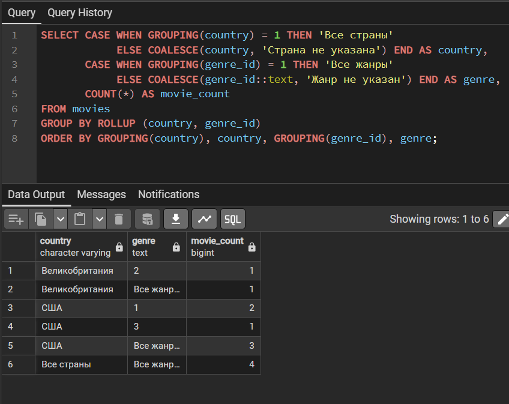

### 10.2. Посчитать билеты по сеансам и статусам с итогами по сеансам и общим итогом.

```sql
SELECT CASE WHEN GROUPING(session_id) = 1 THEN 'Все сеансы'
            ELSE COALESCE(session_id::text, 'Сеанс не указан') END AS session,
       CASE WHEN GROUPING(status) = 1 THEN 'Все статусы'
            ELSE COALESCE(status, 'Статус не указан') END AS status,
       COUNT(*) AS ticket_count
FROM tickets
GROUP BY ROLLUP (session_id, status)
ORDER BY GROUPING(session_id), session_id, GROUPING(status), status;
```

**Пояснение:** Получаем детализацию по статусам внутри сеансов, итог каждого сеанса и общий итог. Это сокращённая запись наборов из запроса 9.2.

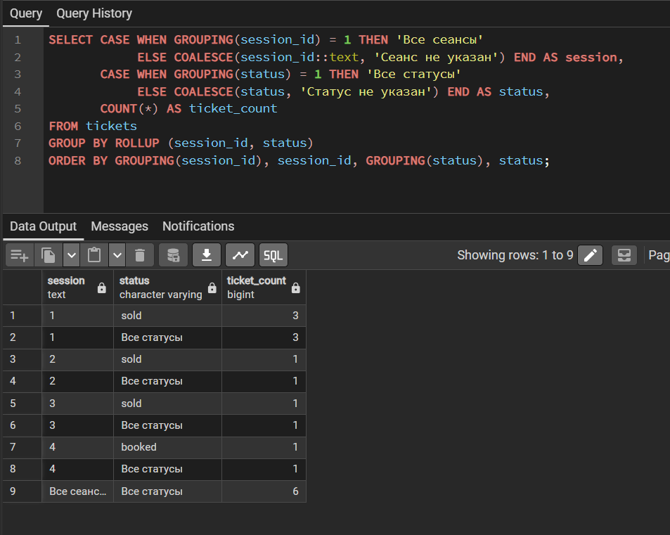

## 11. CUBE

### 11.1. Посчитать фильмы для всех сочетаний страны и жанра с итогами по каждой категории.

```sql
SELECT CASE WHEN GROUPING(country) = 1 THEN 'Все страны'
            ELSE COALESCE(country, 'Страна не указана') END AS country,
       CASE WHEN GROUPING(genre_id) = 1 THEN 'Все жанры'
            ELSE COALESCE(genre_id::text, 'Жанр не указан') END AS genre,
       COUNT(*) AS movie_count
FROM movies
GROUP BY CUBE (country, genre_id)
ORDER BY GROUPING(country), country, GROUPING(genre_id), genre;
```

**Пояснение:** CUBE создаёт (country, genre_id), (country), (genre_id), (). В отличие от ROLLUP, есть и отдельные итоги по жанрам. Отсутствующие в данных сочетания не добавляются.

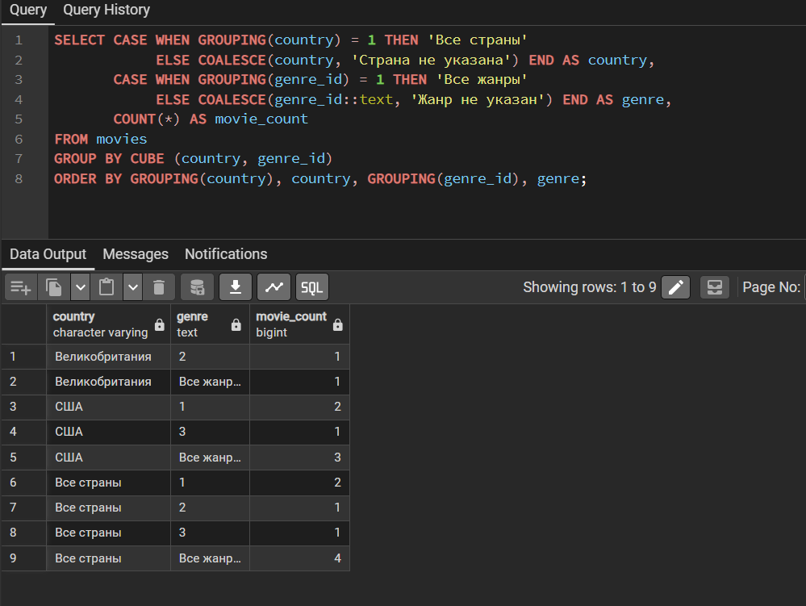

### 11.2. Посчитать сеансы для всех сочетаний зала и формата, включая промежуточные и общий итоги.

```sql
SELECT CASE WHEN GROUPING(hall_id) = 1 THEN 'Все залы'
            ELSE COALESCE(hall_id::text, 'Зал не указан') END AS hall,
       CASE WHEN GROUPING(format) = 1 THEN 'Все форматы'
            ELSE COALESCE(format, 'Формат не указан') END AS format,
       COUNT(*) AS session_count
FROM sessions
GROUP BY CUBE (hall_id, format)
ORDER BY GROUPING(hall_id), hall_id, GROUPING(format), format;
```

**Пояснение:** Получаем группы (hall_id, format), итоги по залам, итоги по форматам и общий итог. Номера залов соответствуют halls.id.

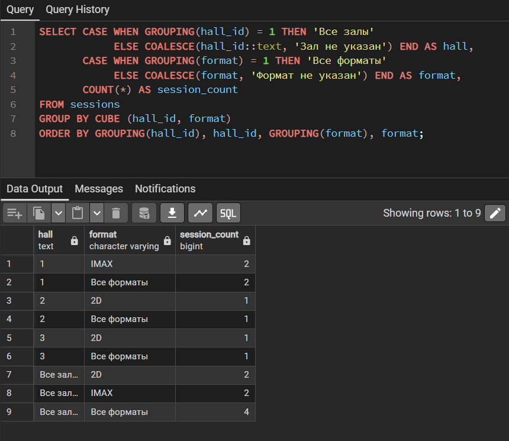

## 12. SELECT, FROM, WHERE, GROUP BY, HAVING, ORDER BY

### 12.1. Среди проданных билетов найти сеансы с двумя и более продажами и вывести сначала самые популярные.

```sql
SELECT session_id, COUNT(*) AS sold_ticket_count
FROM tickets
WHERE status = 'sold'
GROUP BY session_id
HAVING COUNT(*) >= 2
ORDER BY sold_ticket_count DESC, session_id;
```

**Пояснение:** FROM задаёт таблицу; WHERE отбирает строки; GROUP BY собирает группы; HAVING отбирает группы; SELECT формирует столбцы; ORDER BY сортирует результат.

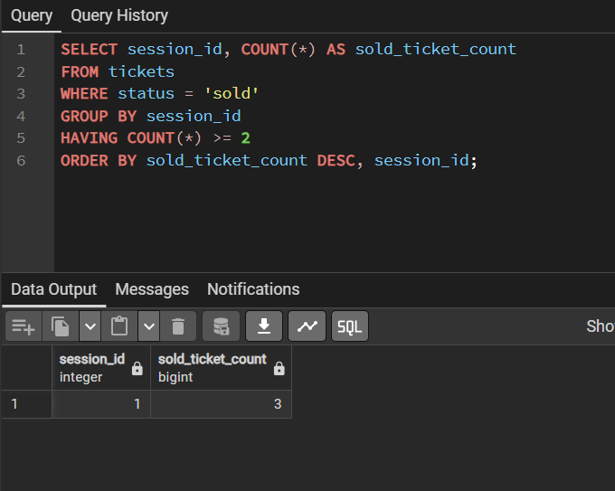

### 12.2. Среди фильмов с рейтингом не ниже 8 найти страны с двумя и более такими фильмами и отсортировать по среднему рейтингу.

```sql
SELECT country, COUNT(*) AS movie_count,
       ROUND(AVG(rating), 2) AS average_rating
FROM movies
WHERE rating >= 8
GROUP BY country
HAVING COUNT(*) >= 2
ORDER BY average_rating DESC, country;
```

**Пояснение:** Сначала отбираем фильмы по рейтингу, потом группируем по стране. В результате остаются страны хотя бы с двумя подходящими фильмами.

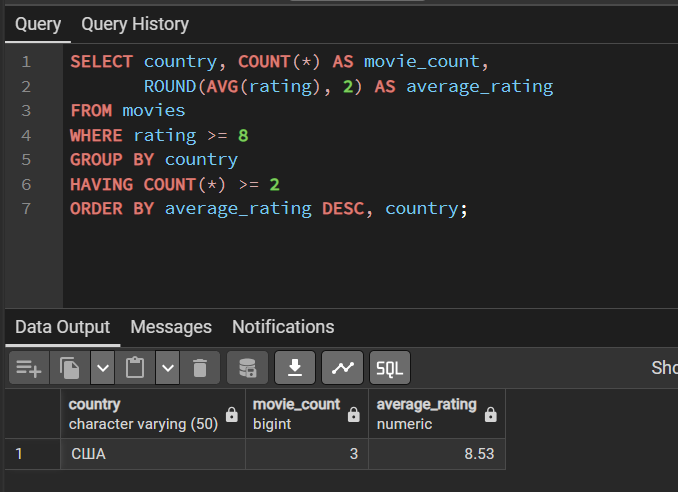


## 13. Комбинирование функций

### 13.1. Посчитать количество фильмов, средний и максимальный рейтинг.

```sql
SELECT COUNT(*) AS movie_count,
       ROUND(AVG(rating), 2) AS average_rating,
       MAX(rating) AS highest_rating
FROM movies;
```

**Пояснение:** Несколько агрегатных функций одновременно рассчитывают показатели по одним строкам.

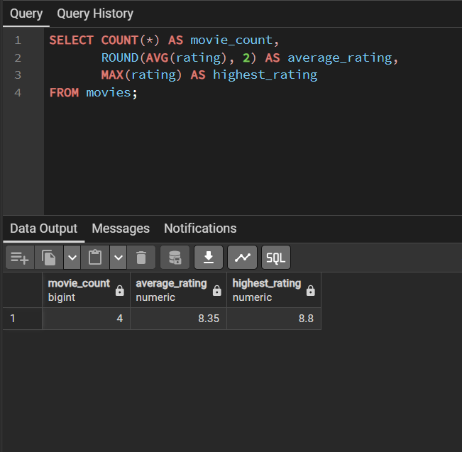

### 13.2. Найти минимальную, среднюю и максимальную цену сеанса.

```sql
SELECT MIN(price) AS minimum_price,
       ROUND(AVG(price), 2) AS average_price,
       MAX(price) AS maximum_price
FROM sessions;
```

**Пояснение:** Один запрос возвращает три характеристики цен.

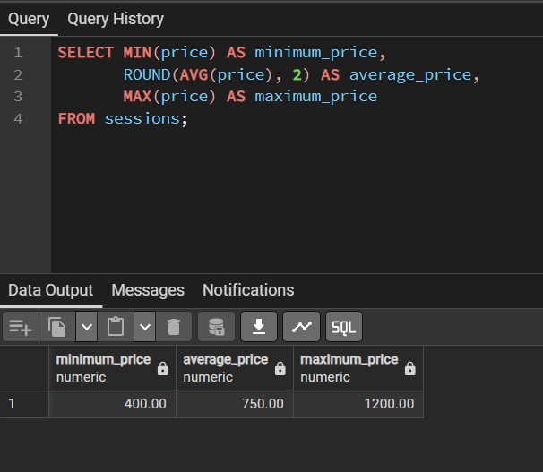


## 14. Разница между WHERE и HAVING

### 14.1. Посчитать по странам фильмы с рейтингом не ниже 8.

```sql
SELECT country, COUNT(*) AS movie_count
FROM movies
WHERE rating >= 8
GROUP BY country
ORDER BY country;
```

**Пояснение:** WHERE удаляет неподходящие строки до группировки. Поэтому считаются только фильмы с рейтингом не ниже 8.

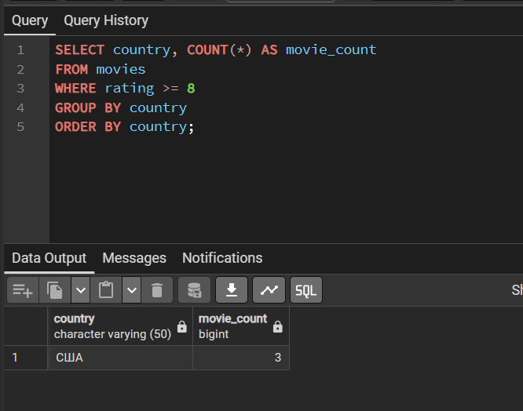

### 14.2. Посчитать все фильмы по странам, оставив страны со средним рейтингом не ниже 8.

```sql
SELECT country, COUNT(*) AS movie_count,
       ROUND(AVG(rating), 2) AS average_rating
FROM movies
GROUP BY country
HAVING AVG(rating) >= 8
ORDER BY country;
```

**Пояснение:** HAVING проверяет средний рейтинг группы после группировки. Внутри подходящей страны учитываются все фильмы, включая фильмы с рейтингом ниже 8.

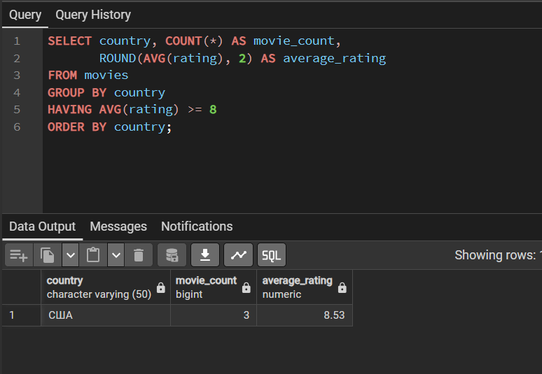


